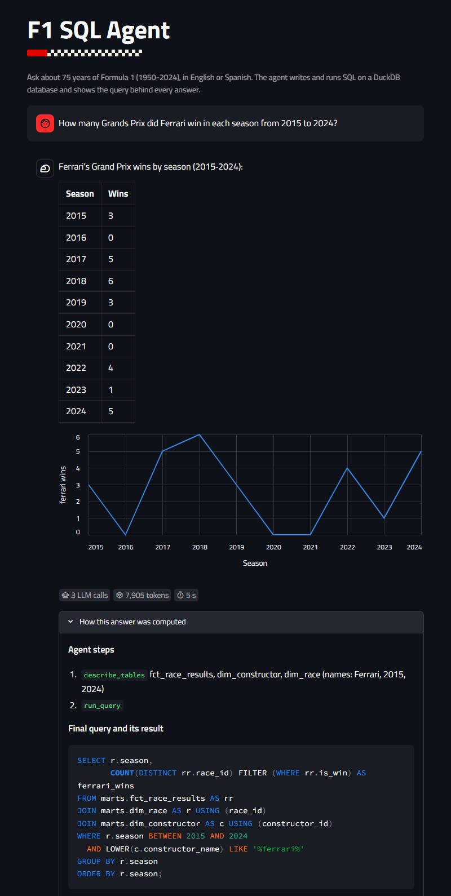
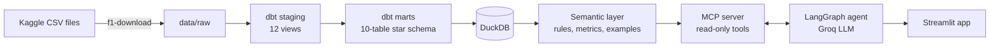
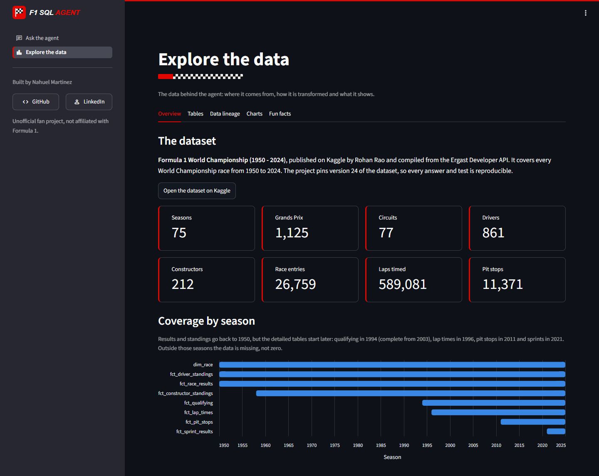
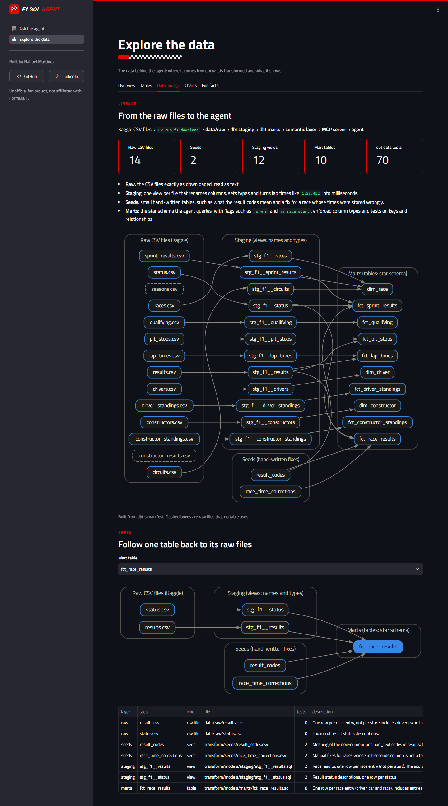
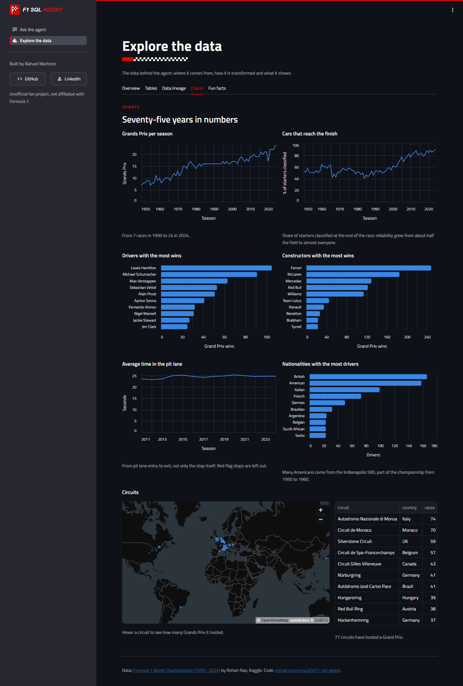
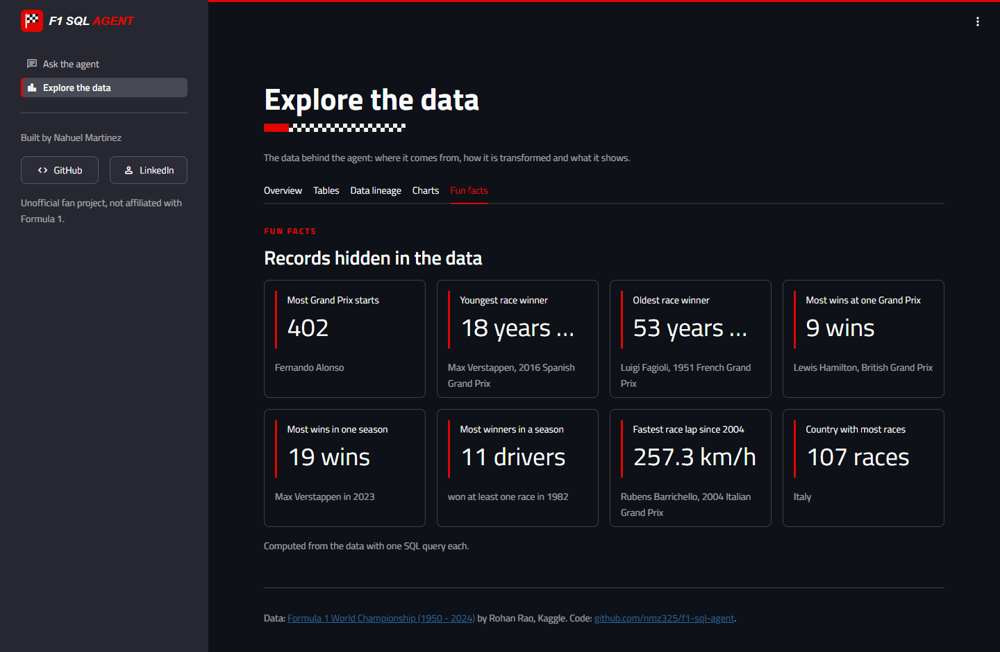

<p align="center">
  
</p>

<h1 align="center">F1 SQL Agent</h1>

<p align="center">
  Ask about 75 years of Formula 1 in plain English or Spanish. An AI agent
  writes the SQL, runs it on a DuckDB star schema built with dbt, and shows
  the query behind every answer.
</p>

<p align="center">
  
</p>

## What it does

- **Answers questions with evidence.** Every answer comes with the agent's
  steps, its final SQL query and the rows that query returned, so it can be
  checked instead of trusted, plus a chart when the rows suit one and what
  the answer cost in LLM calls, tokens and seconds.
- **Knows the data, not just the schema.** A semantic layer tells the agent
  how to count starts, wins and championships correctly (shared cars in the
  1950s, entries that never started, sprints that are not Grands Prix).
- **Is safe by construction.** The model only reaches the database through a
  read-only MCP server: one `SELECT` per call, no file or network access,
  capped rows and a query timeout.
- **Is measured.** Two evaluation sets with verified answers grade the agent
  by execution accuracy, as in the BIRD and Spider text-to-SQL benchmarks.

## Architecture



| Layer | What it does | Where |
|---|---|---|
| Ingestion | Downloads a pinned version of the Kaggle dataset and checks the 14 files | `src/f1_sql_agent/ingest/` |
| Transformation | dbt models: staging views (names, types, lap times in ms) and a star schema with 3 dimensions and 7 facts, enforced contracts and 70 data tests | `transform/` |
| Semantic layer | Structure from dbt's manifest plus hand-written business rules, metrics and verified examples, checked against each other | `semantic/`, `src/f1_sql_agent/semantic/` |
| MCP server | `describe_tables`, `run_query` and more, over a read-only, locked-down DuckDB connection | `src/f1_sql_agent/mcp_server.py` |
| Agent | A LangGraph loop: the LLM calls tools, reads DuckDB's errors to fix its SQL, and gives up after repeated failures | `src/f1_sql_agent/agent.py` |
| Evaluation | Gold SQL, expected rows, grading and Markdown reports | `src/f1_sql_agent/evaluation.py`, `eval/` |
| Web app | Two pages: ask the agent, and explore the data | `app.py`, `app_pages/` |

## Results

**Accuracy.** On the main evaluation set (25 questions, from lookups to window
functions) the agent scored **22/25 (88%)**:

| Level | Questions | Correct |
|---|---|---|
| 1. Lookups | 6 | 5 |
| 2. Aggregations and rankings | 7 | 7 |
| 3. Multi-step and temporal | 7 | 5 |
| 4. Window functions and self-joins | 5 | 5 |

The three failures led to fixes in the prompt and the semantic layer (integer
division in DuckDB, an exact final query, and how to count pit stops).

**Cost.** The Groq free tier allows 8,000 tokens per minute, and 95% of the
tokens were input that every LLM call sends again. Giving the agent the table
list up front and one tool that describes several tables and finds how names
are spelled cut the tokens on three baseline questions **from 50,310 to 21,807
(-57%)**, with the same correct answers.

A full re-run of both evaluation sets with the leaner agent is the next step.

## Explore the data

The second page of the app documents the dataset itself: what each table
holds, which seasons it covers, how data flows from the raw files to the star
schema, charts and records found in the data.

<p align="center">
  
</p>

<p align="center">
  
</p>

<details>
<summary>More screenshots: charts and fun facts</summary>

<p align="center">
  
</p>

<p align="center">
  
</p>

</details>

## Getting started

Requirements: [uv](https://docs.astral.sh/uv/), Git and a free
[Groq API key](https://console.groq.com/keys).

```bash
git clone https://github.com/nmz325/f1-sql-agent.git
cd f1-sql-agent
uv sync
cp .env.example .env              # then add your GROQ_API_KEY

uv run f1-download                # Kaggle CSV files into data/raw
cd transform && uv run dbt build && cd ..   # builds data/f1.duckdb and runs the tests

uv run streamlit run app.py       # the web app, on http://localhost:8501
```

Other commands:

```bash
uv run f1-sql-agent "Who won the 2008 drivers' championship?"   # the agent in the terminal
uv run f1-eval check              # the gold SQL still returns the expected rows
uv run f1-eval run --set simple   # ask the agent the simple set (spends tokens)
uv run f1-eval score --set simple # grade the saved answers, write a report
uv run pytest                     # tests (no LLM, no network)
```

## Deploy

The app runs on [Streamlit Community Cloud](https://share.streamlit.io) as is:
it installs the dependencies from `uv.lock` and, on the first visit, downloads
the data and runs `dbt build` (about a minute). To publish your own copy:

1. Fork this repository and sign in to Streamlit Community Cloud with GitHub.
2. Create an app from the fork: branch `main`, main file `app.py`.
3. In **Advanced settings**, choose Python 3.13 and paste the secrets:

   ```toml
   GROQ_API_KEY = "your-key"
   F1_QUESTION_LIMIT = "5"   # new questions per visitor, to share the free quota
   ```

The public app saves its LLM quota: repeated questions are answered from
memory, each visitor gets `F1_QUESTION_LIMIT` new questions per visit, and
when the main model runs out of quota it switches to `F1_FALLBACK_MODEL`
(`gpt-oss-20b` by default), which has its own.

## Project structure

```
f1-sql-agent/
├── app.py, app_pages/         Streamlit app: navigation, chat page, explore page, styles
├── src/f1_sql_agent/
│   ├── ingest/                Kaggle download
│   ├── semantic/              Manifest loader, business rules, rendering for the LLM
│   ├── mcp_server.py          Read-only database tools
│   ├── agent.py               LangGraph agent
│   ├── evaluation.py          Evaluation sets, grading and reports
│   └── explore.py             Queries and lineage for the explore page
├── transform/                 dbt project: sources, staging, marts, seeds, tests
├── semantic/                  rules.yml, metrics.yml, examples.yml
├── eval/                      questions.yml (main), questions_simple.yml, results
├── tests/                     pytest suite
└── scripts/                   Smoke tests for the Groq key and the MCP server
```

## Data notes

- Data: [Formula 1 World Championship (1950 - 2024)](https://www.kaggle.com/datasets/rohanrao/formula-1-world-championship-1950-2020)
  by Rohan Rao on Kaggle, version 24, compiled from the Ergast Developer API.
- Coverage varies: results and standings start in 1950, qualifying in 1994
  (complete from 2003), lap times in 1996, pit stops in 2011, sprints in 2021.
- Known issue: `is_pole` marks the fastest driver in qualifying, which differs
  from the official pole after exclusions, grid penalties and the 2021 sprint
  format. Lewis Hamilton gets 107 poles in the data instead of the official
  104.

## Tech stack

Python 3.13 · uv · DuckDB · dbt · LangGraph · LangChain · MCP · Groq
(`openai/gpt-oss-120b`) · Streamlit · Altair · pytest · ruff

## Author

Built by **Nahuel Martinez**:
[GitHub](https://github.com/nmz325) ·
[LinkedIn](https://www.linkedin.com/in/nahuel-martinez-77161827b/)

<sub>Unofficial fan project, not associated with Formula 1 companies. F1 and
FORMULA 1 are trademarks of Formula One Licensing B.V.</sub>
